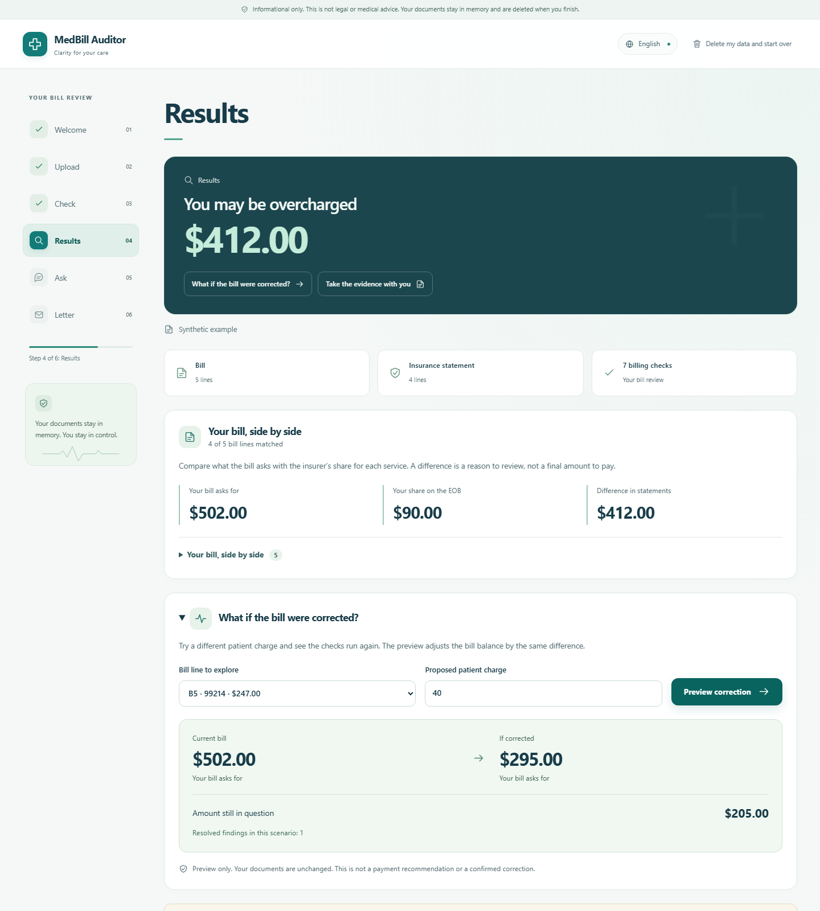
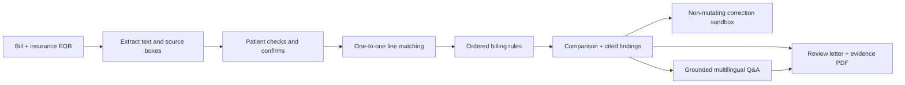

# MedBill

**Understand the charge. Trace the evidence. Ask for a fair review.**

MedBill compares an itemized medical bill with an insurance explanation of benefits (EOB), identifies potential discrepancies, and helps patients ask informed questions in their own language. A deterministic rules engine controls billing findings and amounts; a local language model helps interpret questions and translate explanations.

[Three-minute demo and judging guide](DEMO.md) | [API reference](http://127.0.0.1:8000/docs)

[Open a generated sample evidence report](docs/sample-evidence-report.pdf)



## The patient journey

1. **Add and check documents.** Upload text PDFs, enter lines manually, or explore one of ten explicitly synthetic examples. Compare extracted values with source pages; uncertain fields are highlighted. Confirmation is required before review.
2. **See what disagrees.** Read the bill and insurance amounts side by side, inspect one-to-one line matches, filter findings by certainty, and jump to highlighted source evidence. Weak matches and sample rule data are visible.
3. **Explore a correction.** Change one hypothetical patient charge and rerun the real rules on a deep copy. The original documents and review stay unchanged.
4. **Ask in your language.** Language detection works without a picker. Grounded answers cite case evidence; unsupported coverage, medical, and legal questions are deferred. Original English remains available with translations.
5. **Leave with a next step.** Generate a billing-review letter and download a separate evidence PDF containing the comparison, findings, rule citations, limitations, and highlighted original pages.

In the main synthetic example, the bill asks for **$502**, the EOB lists **$90** in patient responsibility, and the rules identify **$412 in question**. Previewing line B5 at $40 instead of $247 changes the hypothetical balance to **$295**, with **$205 still in question**. Those figures are reproducible outputs from the example, not measured patient savings or a payment recommendation.

## Run it

Requires Python 3.11+, Node.js, and the frontend dependencies. From the repository root in PowerShell:

```powershell
cd medbill
python -m venv .venv
.venv\Scripts\python.exe -m pip install -e . pytest
cd web
npm.cmd ci
cd ..
.venv\Scripts\python.exe scripts/dev.py --check
.venv\Scripts\python.exe scripts/dev.py --demo
```

Open **http://127.0.0.1:5173**. One launcher starts both servers; Ctrl+C stops only the processes it started. Demo mode is reproducible, works offline, and makes no model calls. It uses stored sample extraction and committed English, Spanish, and Mongolian interface/translation resources.

If the ports are already occupied, use distinct ports without stopping another service:

```powershell
.venv\Scripts\python.exe scripts/dev.py --demo --api-port 18080 --web-port 15173
```

Then open **http://127.0.0.1:15173**. On macOS/Linux, use `.venv/bin/python` in place of `.venv\Scripts\python.exe` and `npm` in place of `npm.cmd`.

### Live local AI

```powershell
ollama pull qwen3:4b
.venv\Scripts\python.exe scripts/dev.py --local
```

Ollama must be running. No paid API key is required for the local model. Copy `.env.example` to `.env` to customize `OLLAMA_MODEL` and `OLLAMA_BASE_URL`; startup loads it automatically. The optional Anthropic path is available through `LLM_PROVIDER=anthropic` when starting the API directly, with a key in `.env`.

Clear, self-contained English questions have a checked-data fast path. Other questions use the model, with an English-translation fallback when native routing fails. Successful translations and interpretations are reused in a bounded, per-case memory cache; changed conversations use separate entries, and answers are rebuilt from current bill facts. Translation loops are cancelled early. First-time translations can still take seconds on a CPU.

## How it works



| Layer | Implementation |
| --- | --- |
| Interface | React, TypeScript, Vite, Tailwind; responsive medical visual design, focus management, reduced motion, and right-to-left layouts |
| API | FastAPI and Pydantic; streaming extraction/audit progress, confirmation gates, bounded requests, per-case locks, expiry and deletion |
| Documents | PyMuPDF text and page rendering; Pillow preprocessing; confidence per field and source bounding boxes |
| Billing | Original Python matching and rules; ordered checks avoid counting the same line's impact twice |
| Language | Ollama/Qwen3 locally; optional hosted client; number placeholders, language/repetition checks, fallbacks, and draft glossary resources |
| Export | ReportLab evidence report and letter; source-page annotations are drawn on copies and generated in memory |
| Validation | Pytest, Playwright desktop/375px mobile flows, axe accessibility checks, synthetic fixtures, and opt-in local-model evaluations |

Rules cover duplicate charges, service bundling, excess units, bill/EOB discrepancies, in-network full-price billing, missing insurance lines, price questions, and arithmetic. Rule tables report whether they use sample data or external CMS files. A code-only match with differing dates is explicitly marked for review.

## Verify the prototype

```powershell
# From medbill
.venv\Scripts\python.exe -m pytest -q

# Production frontend build
cd web
npm.cmd run build

# Isolated offline API + browser checks, without replacing a running app
$env:PY = (Resolve-Path '../.venv/Scripts/python.exe').Path
npx.cmd playwright test --workers=2
```

Browser tests use separate ports 18181/15174 by default. Override `MEDBILL_API_PORT` and `MEDBILL_WEB_PORT` if needed. The suite checks the main patient journey, clean and cautious examples, edits, source highlights, language switching, downloads, preview isolation, error recovery, keyboard navigation, overflow, and automated accessibility.

For opt-in live-model measurements on synthetic documents:

```powershell
# From medbill
.venv\Scripts\python.exe scripts/benchmark_local.py --output .pytest_cache/latency.json
.venv\Scripts\python.exe scripts/eval_multilingual.py --stage qa --output .pytest_cache/languages.json
```

These reports measure the selected model and machine. Automated language/number checks do not establish clinical translation accuracy. No accuracy or savings claim is made about real patient bills.

## API additions worth exploring

| Route | Behavior |
| --- | --- |
| `POST /cases` | Uploaded bill/EOB pair, or a named synthetic sample |
| `PATCH /cases/{id}/lines` | Correct source values; clears confirmation and findings |
| `POST /cases/{id}/confirm` | Required before audit, chat, preview, or export |
| `POST /cases/{id}/audit?lang=en` | Cited findings plus line-by-line reconciliation and certainty totals |
| `POST /cases/{id}/preview` | `{line_id, patient_owed}`; reruns rules on a copy and adjusts hypothetical balance by the same delta |
| `POST /cases/{id}/ask` | Question, optional conversation, and automatic language detection |
| `GET /cases/{id}/report?format=pdf` | Evidence packet with annotated source pages; `format=json` exposes its structured data |
| `GET /cases/{id}/letter` | English review letter with PDF/text output and optional side-by-side reading translation |
| `DELETE /cases/{id}` | Removes the case and its runtime translation cache; idle cases expire after `CASE_TTL_SECONDS` |

## What is real, and what comes next

This is a hackathon prototype built and evaluated with synthetic cases. Potential discrepancies are reasons to ask for review, not confirmed overcharges, savings, or final payment instructions. It is informational and does not provide medical or legal advice.

- **Data coverage:** some NCCI, MUE, and fee tables are small samples. CMS download tooling exists; broader coverage and licensed descriptions need further work. CPT descriptions are not redistributed.
- **Extraction:** text PDFs and manual entry work locally. Synthetic photo samples replay stored extraction; arbitrary real photos need a vision reader. Sample extraction is not represented as a live OCR accuracy result.
- **Languages:** valid language codes are not limited to the offline demo languages. Live output quality varies. Spanish and Mongolian resources are drafts requiring native-speaker review; protecting numbers does not prove that the prose is accurate.
- **Privacy:** case records and runtime caches stay in memory, with deletion and idle expiry. Extraction uses temporary files removed after processing. There is no patient database, authentication, or production compliance certification. Use synthetic documents for the demo.
- **Next:** patient-advocate usability testing, native-speaker review, broader validated rule data, stronger real-document extraction, and measured deployment performance.
